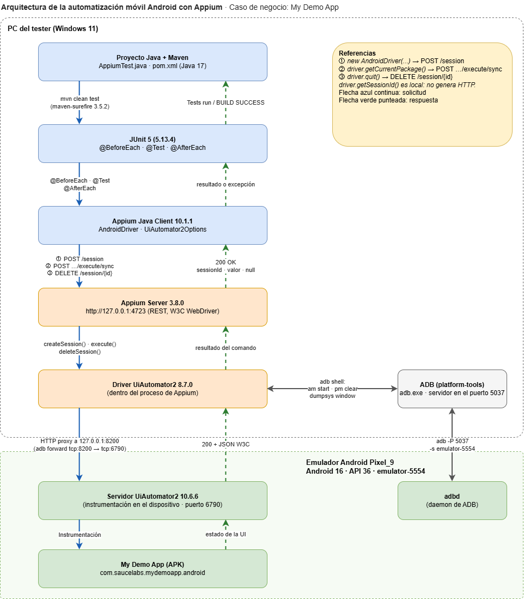
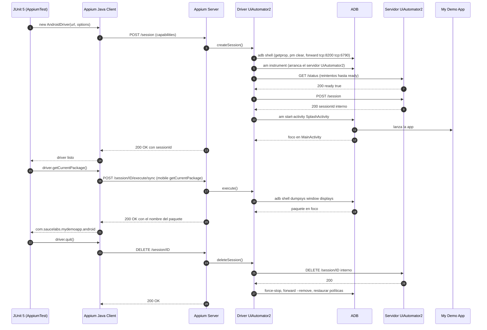

# Arquitectura de la automatización móvil Android con Appium

**Proyecto:** `appium-mobile-automation`
**App bajo prueba:** My Demo App de Sauce Labs (`mda-2.2.0-25.apk`, paquete `com.saucelabs.mydemoapp.android`)
**Evidencia:** ejecución de `AppiumTest` con el servidor iniciado como `appium --log-level debug --log appium.log`. Las horas del log están en UTC.

## 1. Objetivo

Documentar los componentes que intervienen cuando una prueba escrita en Java ejecuta una acción sobre una aplicación nativa Android, qué hace cada uno y cómo se comunican. Todo lo que figura abajo se contrastó con el log de una ejecución real.

## 2. Componentes y responsabilidades

| # | Componente | Dato del entorno | Responsabilidad | Participación durante la prueba |
|---|---|---|---|---|
| 1 | Proyecto Java y Maven | Java 17 (`maven.compiler.release`), compilado con JDK 18.0.2.1. Surefire 3.5.2 | Organiza el código y las dependencias y ejecuta el build | `mvn clean test` compila y lanza las clases de `src/test/java` |
| 2 | JUnit 5 | 5.13.4 | Define las pruebas y su ciclo de vida | `@BeforeEach` crea la sesión, `@Test` verifica, `@AfterEach` la cierra |
| 3 | Appium Java Client | 10.1.1 | Traduce las llamadas Java en solicitudes HTTP del protocolo W3C WebDriver | `UiAutomator2Options` arma las capabilities y `AndroidDriver` envía las solicitudes |
| 4 | Appium Server | 3.8.0, escucha en `127.0.0.1:4723` | Recibe las solicitudes, elige el driver según las capabilities y administra las sesiones | Atiende `POST /session`, `POST …/execute/sync` y `DELETE /session/{id}` |
| 5 | Driver UiAutomator2 | 8.7.0, corre dentro del proceso de Appium | Conoce Android: prepara el dispositivo, instala y arranca el servidor de UiAutomator2 y resuelve cada comando | Crea la sesión, lanza la app, resuelve `getCurrentPackage` y limpia todo al cerrar |
| 6 | ADB | `adb.exe` de platform-tools, servidor en el puerto 5037 | Canal entre la PC y el dispositivo: ejecuta comandos de shell y redirige puertos | `am start-activity`, `pm clear`, `dumpsys window displays`, `forward tcp:8200 tcp:6790` |
| 7 | Servidor UiAutomator2 | 10.6.6, se ejecuta en el dispositivo (puerto 6790) | Recibe pedidos HTTP del driver y los ejecuta sobre la interfaz como un proceso de instrumentación | Atiende la creación de su sesión interna y las consultas del dispositivo |
| 8 | Emulador Android | AVD Pixel_9, Android 16 (API 36), `emulator-5554` | Dispositivo virtual donde corre la app | Aloja el servidor de UiAutomator2, `adbd` y la aplicación |
| 9 | Aplicación nativa (APK) | My Demo App 2.2.0 | Aplicación bajo prueba | Se lanza por `SplashActivity` y queda en foco en `MainActivity` |

## 3. Diagrama de arquitectura



El archivo editable es [`diagrama-arquitectura.drawio`](diagrama-arquitectura.drawio). En azul continuo van las solicitudes y en verde punteado las respuestas.

Recorrido de una ejecución completa en formato secuencia (GitHub lo muestra renderizado):



## 4. Mecanismos de comunicación

| Tramo | Mecanismo | Evidencia en el log |
|---|---|---|
| JUnit 5 → Appium Java Client | Llamadas Java dentro de la misma JVM | No genera tráfico de red |
| Appium Java Client ↔ Appium Server | **HTTP con JSON (W3C WebDriver)** sobre `http://127.0.0.1:4723` | Líneas `[HTTP] -->` y `[HTTP] <--` |
| Appium Server → Driver UiAutomator2 | Llamadas internas dentro del proceso de Appium | `Calling AppiumDriver.createSession()`, `execute()`, `deleteSession()` |
| Driver UiAutomator2 ↔ ADB | Procesos `adb.exe -P 5037 -s emulator-5554 shell …` | Líneas `[ADB] Running '…'` |
| Driver UiAutomator2 ↔ Servidor UiAutomator2 | **HTTP proxy** a `127.0.0.1:8200`, redirigido por ADB al puerto 6790 del emulador | `adb forward tcp:8200 tcp:6790` y `Proxying [POST /session] to [POST http://127.0.0.1:8200/session]` |
| Servidor UiAutomator2 ↔ App | Instrumentación de Android (`am instrument`) que opera sobre la interfaz | `am instrument -w … AndroidJUnitRunner` |

## 5. Recorrido de la prueba, con los tiempos del log

1. **Configuración y creación de la sesión.** El cliente envía `POST /session` con `platformName`, `appium:automationName`, `appium:udid`, `appium:deviceName`, `appium:app` y `appium:appWaitActivity`. Appium encuentra el driver `uiautomator2` y le delega la creación.
2. **Preparación del dispositivo.** El driver consulta la versión de Android (API 36), relaja la política de APIs ocultas, lee el manifiesto del APK y verifica que `io.appium.settings` y el servidor de UiAutomator2 estén instalados. La app ya estaba instalada del avance anterior, por eso Appium no la reinstaló (`There is no need to install/upgrade`) y solo hizo un *fast reset*: `am force-stop` y `pm clear`.
3. **Arranque del servidor de UiAutomator2.** Se redirige el puerto (`adb forward tcp:8200 tcp:6790`), se lanza `am instrument` y el driver consulta `GET /status` una vez por segundo. Las primeras 6 respuestas fueron `socket hang up` (el servidor todavía no estaba listo) y la séptima fue `200` con `"ready":true`. La inicialización tardó **6176 ms**.
4. **Sesión interna.** El driver reenvía `POST /session` al servidor de UiAutomator2, que responde `200` con su propio `sessionId` (`d88d70fb…`), distinto del que ve el cliente (`548e832c…`).
5. **Lanzamiento de la app.** `am start-activity -W` abre `SplashActivity` y Appium espera cualquier actividad (`*`). El foco termina en `MainActivity`.
6. **Respuesta al cliente.** `POST /session` devuelve `200` en **13133 ms**, con el `sessionId`.
7. **Comando.** `getCurrentPackage()` viaja como `POST …/execute/sync` con `mobile: getCurrentPackage` y vuelve `200` en **127 ms** con `"com.saucelabs.mydemoapp.android"`.
8. **Cierre.** `DELETE /session/{id}` borra la sesión interna del servidor de UiAutomator2, detiene la instrumentación y la app, quita el `forward` y restaura la configuración del emulador. Devuelve `200` en **1625 ms**.

## 6. Relación código–arquitectura

Instrucciones principales de `AppiumTest.java` y el componente donde se resuelve cada una:

```java
@BeforeEach
public void configurarSesion() throws Exception {
    UiAutomator2Options options = new UiAutomator2Options();      // (a)
    options.setDeviceName("emulator-5554");
    options.setUdid("emulator-5554");
    options.setApp(apk.toString());
    options.setAppWaitActivity("*");

    driver = new AndroidDriver(new URL("http://127.0.0.1:4723"), options);  // (b)
}

@Test
public void verificarAplicacionAbierta() {
    assertNotNull(driver.getSessionId());                          // (c)
    assertEquals("com.saucelabs.mydemoapp.android",
                 driver.getCurrentPackage());                      // (d)
}

@AfterEach
public void finalizarSesion() {
    if (driver != null) { driver.quit(); }                         // (e)
}
```

| | Instrucción | Etapa | Solicitud HTTP del log | Componentes que intervienen |
|---|---|---|---|---|
| (a) | `UiAutomator2Options` | Configuración inicial | Ninguna: arma las capabilities en memoria | Appium Java Client |
| (b) | `new AndroidDriver(url, options)` | Creación de la sesión | `POST /session` → `200` | Java Client → Appium Server → Driver UiAutomator2 → ADB → Servidor UiAutomator2 → Emulador y App |
| (c) | `driver.getSessionId()` | Ejecución | **Ninguna**: el id ya llegó en la respuesta de (b) | Solo el Java Client |
| (d) | `driver.getCurrentPackage()` | Ejecución de un comando | `POST /session/{id}/execute/sync` → `200` | Java Client → Appium Server → Driver UiAutomator2 → ADB (`dumpsys window displays`) |
| (e) | `driver.quit()` | Finalización | `DELETE /session/{id}` → `200` | Java Client → Appium Server → Driver UiAutomator2 → Servidor UiAutomator2 y ADB |

## 7. Códigos de estado observados

| Solicitud | Estado | Tiempo | Significado |
|---|---|---|---|
| `POST /session` | 200 OK | 13133 ms | Sesión creada, devuelve `sessionId` y las capabilities |
| `POST /session/{id}/execute/sync` | 200 OK | 127 ms | Comando ejecutado, devuelve el paquete |
| `DELETE /session/{id}` | 200 OK | 1625 ms | Sesión finalizada y recursos liberados |

Todas las respuestas del cliente fueron 200. Los `socket hang up` del paso 3 no son errores HTTP del cliente: son reintentos internos del driver mientras el servidor de UiAutomator2 terminaba de arrancar.

## 8. Observaciones

- **El recorrido no siempre pasa por el servidor de UiAutomator2.** En esta prueba `getCurrentPackage()` lo resolvió el driver directamente con ADB (`dumpsys window displays`). El servidor de UiAutomator2 intervino al crear y al cerrar la sesión y en las consultas del dispositivo (`pixel_ratio`, `system_bars`, tamaño de ventana e información del dispositivo). Los comandos sobre elementos de la interfaz (buscar, tocar, escribir) sí se proxean a él.
- **La ruta difiere del ejemplo del curso.** El material de práctica muestra `GET …/appium/device/current_package`, pero con java-client 10.1.1 la llamada viaja como `POST …/execute/sync` con `mobile: getCurrentPackage`. El propio material aclara que las rutas varían según la versión.
- **`appium:appWaitActivity` = `*`.** La app abre `SplashActivity` y enseguida pasa a `MainActivity`. Sin el comodín, Appium espera una actividad que ya desapareció y falla con `SplashActivity never started`.
- **Cada sesión empieza limpia.** Como no se configuró `noReset`, Appium borra los datos de la app (`pm clear`) al iniciar.
- **Dos identificadores de sesión.** El cliente conoce el de Appium. El servidor de UiAutomator2 maneja otro, interno, que el cliente nunca ve.
