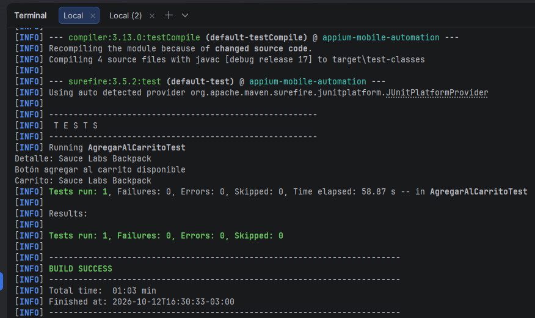

# Avance 2.4 – Interacciones básicas con elementos móviles

## Flujo automatizado

Listado de productos → Seleccionar Backpack → Detalle → Agregar al carrito → Abrir carrito → Verificar producto

Clase: `src/test/java/AgregarAlCarritoTest.java` (JUnit 5). La sesión de Appium se crea con `DriverFactory` (configuración en `config.properties`) y se cierra en `@AfterEach`.

## Configuración para ejecutar

1. Emulador Android iniciado (`adb devices` debe mostrar `emulator-5554`).
2. Appium en ejecución: `appium`
3. `mvn clean test -Dtest=AgregarAlCarritoTest`

## Localizadores utilizados

| Paso | Elemento | Estrategia | Valor |
|---|---|---|---|
| Esperar listado | Título "Products" | ID | `com.saucelabs.mydemoapp.android:id/productTV` |
| Seleccionar producto | Imagen del primer producto | Accessibility ID | `Product Image` (primer resultado) |
| Validar detalle | Nombre del producto | ID | `com.saucelabs.mydemoapp.android:id/productTV` (texto contiene `Backpack`) |
| Botón agregar | Add to cart | Accessibility ID | `Tap to add product to cart` |
| Abrir carrito | Ícono del carrito | Accessibility ID | `View cart` |
| Validar carrito | Nombre del producto | ID | `com.saucelabs.mydemoapp.android:id/titleTV` (texto contiene `Backpack`) |

## Esperas explícitas

Se usa `WebDriverWait` de 20 segundos, sin `Thread.sleep()`:

- `visibilityOfElementLocated`: listado de productos.
- `elementToBeClickable`: imagen del producto, botón agregar y acceso al carrito.
- `textToBePresentInElementLocated`: nombre en detalle y en carrito. En el detalle `productTV` es el mismo ID que el título "Products" del listado, por eso se espera por el texto "Backpack" y no solo por la visibilidad.

## Validaciones

- El nombre del detalle contiene `Backpack`.
- El botón Agregar al carrito está visible y habilitado.
- El nombre del producto en el carrito contiene `Backpack`.

## Evidencia

Captura de la ejecución con `Tests run: 1, Failures: 0` y `BUILD SUCCESS`: `capturas/06-ejecucion-exitosa.png`

