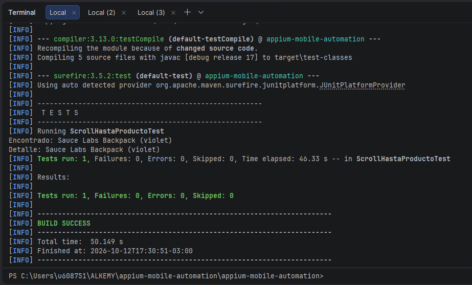

# Avance 2.5 – Gestos y acciones móviles (Scroll)

## Flujo automatizado

Abrir Sauce Demo → Esperar catálogo → Scroll hasta "Sauce Labs Backpack (violet)" → Verificar que esté visible → Click → Detalle → Validar nombre

Clase: `src/test/java/ScrollHastaProductoTest.java` (JUnit 5). La sesión se crea con `DriverFactory` y se cierra en `@AfterEach`.

## Producto utilizado

Se usa **Sauce Labs Backpack (violet)**. Está al final del catálogo, por lo que no es visible al abrir la app y requiere scroll para encontrarlo.

## Método reutilizable

```java
private WebElement scrollAbajoHasta(String texto) { ... }
```

Recibe el texto exacto del elemento y devuelve el `WebElement` ya visible. Usa `UiScrollable` con `UiSelector` de UiAutomator, sin coordenadas fijas, así que sirve para cualquier otro producto del catálogo (por ejemplo `scrollAbajoHasta("Sauce Labs Backpack (yellow)")`).

Selector usado:

```
new UiScrollable(new UiSelector().scrollable(true)).setAsVerticalList()
    .scrollIntoView(new UiSelector().text("<texto>"))
```

## Configuración para ejecutar

1. Emulador Android iniciado (`adb devices` debe mostrar `emulator-5554`).
2. Appium en ejecución: `appium`
3. `mvn clean test -Dtest=ScrollHastaProductoTest`

## Localizadores utilizados

| Paso | Elemento | Estrategia | Valor |
|---|---|---|---|
| Esperar catálogo | Título "Products" | ID | `com.saucelabs.mydemoapp.android:id/productTV` |
| Scroll | Contenedor desplazable | UiAutomator | `new UiSelector().scrollable(true)` |
| Encontrar producto | Nombre del producto | UiAutomator | `new UiSelector().text("<texto>")` |
| Seleccionar producto | Imagen de la misma tarjeta (la única con click) | UiAutomator | `new UiSelector().text("Sauce Labs Backpack (violet)").fromParent(new UiSelector().description("Product Image"))` |
| Validar detalle | Nombre en el detalle | ID | `com.saucelabs.mydemoapp.android:id/productTV` (texto contiene `Sauce Labs Backpack (violet)`) |

## Esperas explícitas

`WebDriverWait` de 20 segundos, sin `Thread.sleep()`:

- `visibilityOfElementLocated`: catálogo cargado y producto visible tras el scroll.
- `elementToBeClickable`: antes del click sobre la imagen del producto.
- `textToBePresentInElementLocated`: nombre del detalle. `productTV` también existe en el catálogo, por eso se espera por el texto.

## Validaciones

- El producto está visible después del scroll (`isDisplayed()`).
- El nombre en el detalle contiene `Sauce Labs Backpack (violet)`.

## Evidencia

Ejecución con `Tests run: 1, Failures: 0, Errors: 0` y `BUILD SUCCESS`:


