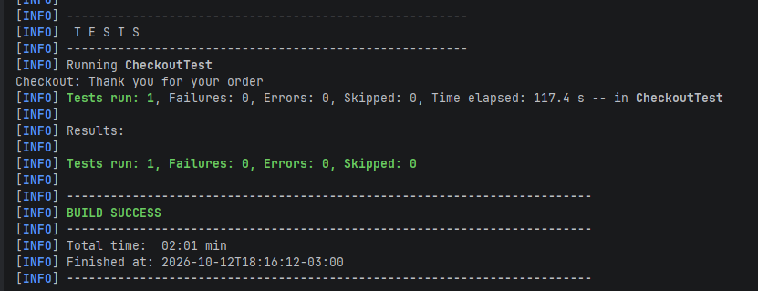

# Avance 2.6 – Esperas y sincronización en Mobile I

## Objetivo

Incorporar esperas explícitas (`WebDriverWait` + `ExpectedConditions`) en el flujo de Checkout de My Demo App, sin ningún `Thread.sleep()`.

Clase: `src/test/java/CheckoutTest.java` (JUnit 5). Mantiene la estructura del proyecto: la sesión se crea con `DriverFactory` y se cierra en `@AfterEach`.

## Flujo

Catálogo → Backpack → Agregar al carrito → Carrito → Proceed To Checkout → Login → Envío → Pago → Revisión → Place Order → Checkout Complete

## Configuración para ejecutar

1. Emulador Android iniciado (`adb devices` debe mostrar `emulator-5554`).
2. Appium en ejecución: `appium`
3. `mvn clean test -Dtest=CheckoutTest`

## WebDriverWait

Una sola instancia con un tiempo máximo de 20 segundos:

```text
wait = new WebDriverWait(driver, Duration.ofSeconds(20))
```

Si el elemento aparece antes, el test sigue de inmediato. Solo se agota el tiempo cuando algo realmente falla.

## Esperas aplicadas en cada punto del flujo

| Pantalla | Qué se espera | ExpectedCondition | Por qué hace falta |
|---|---|---|---|
| Catálogo | Título `productTV` | `visibilityOfElementLocated` | La app tarda en cargar el listado al abrir. |
| Catálogo | Imagen del producto | `elementToBeClickable` | Solo la imagen recibe el click. |
| Detalle | Texto `Backpack` en `productTV` | `textToBePresentInElementLocated` | `productTV` también existe en el catálogo; esperar por el texto confirma que cambió la pantalla. |
| Detalle | Botón `Tap to add product to cart` | `elementToBeClickable` | Antes de agregar el producto. |
| Detalle | Acceso `View cart` | `elementToBeClickable` | Antes de abrir el carrito. |
| Carrito | Texto `Backpack` en `titleTV` | `textToBePresentInElementLocated` | Confirma que el producto está en el carrito. |
| Carrito | Botón `Confirms products for checkout` | `elementToBeClickable` | Antes de iniciar el checkout. |
| Login | Campos `nameET` y `passwordET` | `visibilityOfElementLocated` | Esperar el campo sincroniza el cambio de pantalla antes de escribir. |
| Login | Botón `loginBtn` | `elementToBeClickable` | Antes de iniciar sesión. |
| Envío | Campos `fullNameET`, `address1ET`, `cityET`, `stateET`, `zipET`, `countryET` | `visibilityOfElementLocated` | Esperar cada campo antes de ingresar información. |
| Envío | `paymentBtn` con texto `To Payment` | `textToBePresentInElementLocated` + `elementToBeClickable` | `paymentBtn` es el mismo ID en tres pantallas; el texto confirma en cuál estamos. |
| Pago | Campos `nameET`, `cardNumberET`, `expirationDateET`, `securityCodeET` | `visibilityOfElementLocated` | Igual que en Envío. |
| Pago | `paymentBtn` con texto `Review Order` | `textToBePresentInElementLocated` + `elementToBeClickable` | Igual que en Envío. |
| Revisión | `placeOrderRV`, `fullNameTV`, `itemNumberTV` | `visibilityOfElementLocated` | Se valida el resumen antes de confirmar. |
| Revisión | `paymentBtn` con texto `Place Order` | `textToBePresentInElementLocated` + `elementToBeClickable` | Igual que en Envío. |
| Confirmación | Texto `Checkout Complete` en `completeTV` | `textToBePresentInElementLocated` | Marca el fin del flujo; el pedido se procesa contra el servidor y puede tardar. |
| Confirmación | `thankYouTV` | `visibilityOfElementLocated` | Validación final. |

## Esperas fijas eliminadas

Antes de este avance, el flujo no tenía esperas fijas: se agregó desde el principio con `WebDriverWait`. El código no contiene ningún `Thread.sleep()` (se puede comprobar con una búsqueda de texto en el proyecto).

## Localizadores utilizados

Todos provienen del mapeo de `docs/mapeo-elementos.md`. Estrategia principal: ID. Se usa Accessibility ID donde el elemento no tiene un ID único (`Product Image`, `Tap to add product to cart`, `View cart`, `Confirms products for checkout`). Para llegar a un botón fuera de pantalla se usa UiAutomator (`UiScrollable`).

## Validaciones

- El producto del carrito es el Backpack.
- El resumen de revisión muestra el nombre de envío y 1 ítem.
- La pantalla final muestra `Checkout Complete` y `Thank you for your order`.

## Evidencia

Ejecución con `Tests run: 1, Failures: 0, Errors: 0` y `BUILD SUCCESS`:


