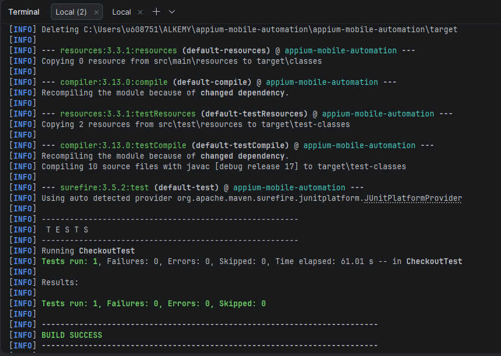
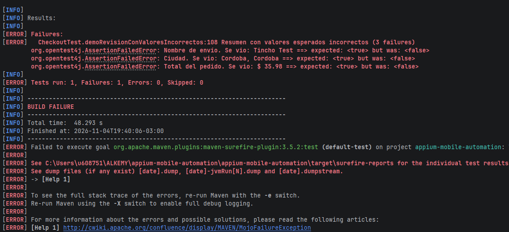

# Avance 3.1 – Repaso de JUnit 5: aserciones agrupadas con `assertAll()`

## Objetivo

Validar con `assertAll()` los datos que muestra la pantalla de **revisión del pedido** (Checkout) de My Demo App, de modo que una sola ejecución informe todos los datos incorrectos y no solo el primero.

Clase: `src/test/java/CheckoutTest.java`, método `revisionMuestraLosDatosIngresados`.

## Elementos del Checkout analizados

Pantalla de revisión del pedido (detalle en [`mapeo-elementos.md`](mapeo-elementos.md)):

| Dato | Elemento (`resource-id`) | Valor esperado |
|---|---|---|
| Nombre de envío | `fullNameTV` | El nombre ingresado en el envío (`Tincho Test`) |
| Dirección | `addressTV` | La dirección ingresada (`Av. Colon 123`) |
| Ciudad | `cityTV` | La ciudad ingresada (`Cordoba`) |
| País | `countryTV` | El país ingresado (`Argentina`) |
| Titular de la tarjeta | `cardHolderTV` | El nombre ingresado en el pago (`Tincho Test`) |
| Cantidad de ítems | `itemNumberTV` | Contiene `1` (un producto en el carrito) |
| Total del pedido | `totalAmountTV` | Contiene `35.98` (`$ 29.99` del producto más el envío, según se observó en el relevamiento) |

Los valores esperados salen de los datos que el mismo test ingresó en las pantallas anteriores (constantes `NOMBRE`, `DIRECCION`, `CIUDAD`, `PAIS`) y del producto elegido.

## Cómo se aplica

Después de completar el pago, el test lee los siete textos y los comprueba juntos:

```text
assertAll("Resumen del pedido",
    () -> assertTrue(resumen.nombre().contains(NOMBRE), ...),
    () -> assertTrue(resumen.direccion().contains(DIRECCION), ...),
    () -> assertTrue(resumen.ciudad().contains(CIUDAD), ...),
    () -> assertTrue(resumen.pais().contains(PAIS), ...),
    () -> assertTrue(resumen.titular().contains(NOMBRE), ...),
    () -> assertTrue(resumen.items().contains("1"), ...),
    () -> assertTrue(resumen.total().contains(TOTAL_ESPERADO), ...))
```

- Se usa `assertTrue()` con `contains()` porque la app agrega texto alrededor del valor (por ejemplo `1 Items` o `$ 35.98`).
- `assertAll()` ejecuta **todas** las comprobaciones, aunque alguna falle, y al final informa el conjunto de errores.
- Cada aserción lleva un mensaje con lo que se vio en pantalla, para identificar el problema sin depurar.
- El mismo avance usa `assertNotNull()` y `assertEquals()` en `AppiumTest` (sesión creada y paquete de la app) y `assertAll()` también en las pruebas de Login, Logout, Catálogo y Carrito.

Se reutilizan las clases y localizadores existentes: `BaseTest` (sesión y esperas), los datos del flujo de compra y `scrollHastaId()` para llegar a los elementos que quedan fuera de pantalla en la revisión.

## Ejecución exitosa

```bash
mvn clean test -Dtest=CheckoutTest#revisionMuestraLosDatosIngresados
```

Resultado esperado: `Tests run: 1, Failures: 0, Errors: 0`.

Evidencia: `capturas/09-assertall-exitoso.png`



## Ejecución fallida controlada

Para mostrar cómo informa los errores `assertAll()`, el método `demoRevisionConValoresIncorrectos` compara el mismo resumen con **tres valores incorrectos a propósito** (un nombre, una ciudad y un total que no corresponden). Está desactivado por defecto y se activa solo con una propiedad de sistema, de modo que la suite normal no falla:

```bash
mvn clean test "-Dtest=CheckoutTest#demoRevisionConValoresIncorrectos" "-DdemoFallo=true"
```

Resultado esperado: el test falla con un único mensaje `Resumen con valores esperados incorrectos (3 failures)` que lista los tres errores y lo que se vio en pantalla en cada uno. Con aserciones sueltas, el primer error habría detenido el test y los otros dos quedarían ocultos.

Evidencia: `capturas/10-assertall-fallido.png`



## Entregables

- Código fuente actualizado: `CheckoutTest.java`, con `assertAll()` en la revisión del pedido y en la confirmación.
- Validaciones funcionales: siete datos de la pantalla de revisión (el mínimo pedido es tres).
- Evidencia de ejecución exitosa y fallida: capturas 09 y 10.
- Proyecto funcional: se ejecuta con `mvn clean test`.
