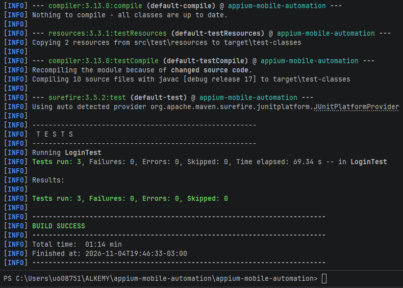
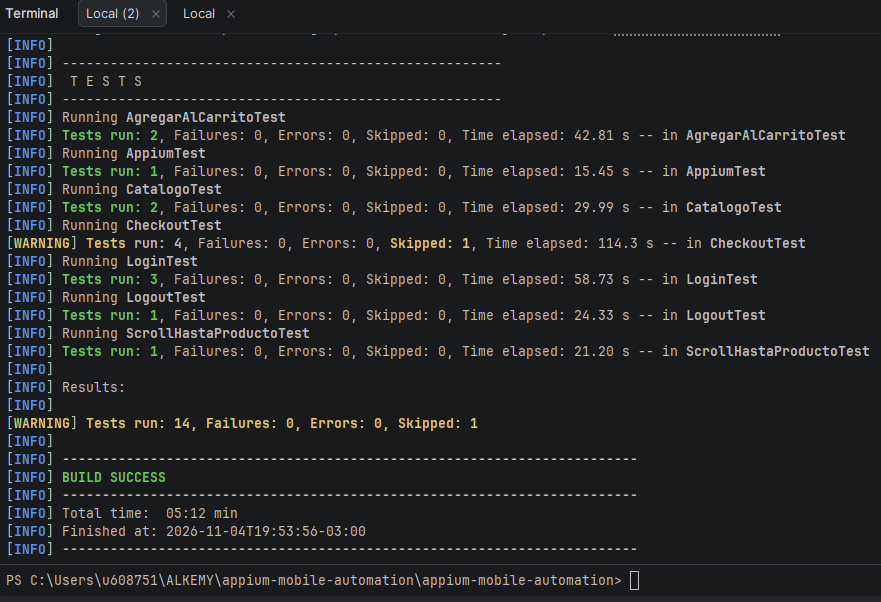

# Avance 3.2 – Organización y estructura de pruebas mobile

## Objetivo

Dividir el flujo de e-commerce en métodos de prueba independientes, estructurados con el patrón **AAA** (Arrange, Act, Assert) y clasificados por pantalla con `@Tag`, para poder ejecutar solo Login, Productos, Carrito, Checkout o Logout.

## Funcionalidades y pruebas

Antes, el checkout completo era un único método largo. Ahora cada etapa tiene su propio método y cada método arma su propio estado: no depende de que otro haya corrido antes.

| Etiqueta | Clase | Métodos |
|---|---|---|
| `Login` | `LoginTest` | `loginExitosoLlevaAlCatalogo`, `loginConUsuarioBloqueadoMuestraError`, `loginSinUsuarioMuestraError` |
| `Products` | `CatalogoTest` | `catalogoMuestraProductosConNombreYPrecio`, `catalogoPermiteAccederAlCarrito` |
| `Products` | `ScrollHastaProductoTest` | `scrollSeleccionarProductoYValidarDetalle` |
| `Products` | `AgregarAlCarritoTest` | `detalleMuestraBotonAgregarDisponible` (etiqueta a nivel de método) |
| `Cart` | `AgregarAlCarritoTest` | `productoAgregadoApareceEnElCarrito` |
| `Checkout` | `CheckoutTest` | `envioConDatosValidosLlevaAlPago`, `revisionMuestraLosDatosIngresados`, `compraCompletaMuestraConfirmacion` |
| `Logout` | `LogoutTest` | `logoutVuelveALaPantallaDeLogin` |
| `Smoke` | `AppiumTest` | `verificarAplicacionAbierta` |
| `Android` | todas | La etiqueta está en `BaseTest` y la heredan todas las clases |

Además, `CheckoutTest.demoRevisionConValoresIncorrectos` (etiqueta `Demo`) solo corre con `-DdemoFallo=true`; es la prueba de demostración del Avance 3.1.

## Patrón AAA

Cada método tiene tres bloques identificados con comentarios:

```text
// Arrange: dejar la app en el estado de partida
// Act:     realizar la acción que se prueba
// Assert:  verificar el resultado con aserciones
```

Ejemplo (Logout):

```text
// Arrange: usuario con sesión iniciada
loginExitoso();

// Act: Menú -> Log Out -> confirmar
hacerLogout();
boolean botonLogin = esperarVisible(id("loginBtn")).isDisplayed();

// Assert
assertAll("Pantalla de Login después del logout", ...)
```

Los pasos de preparación repetidos (ir al login, iniciar sesión, cerrar sesión, esperas, scroll) están como métodos en `BaseTest` o como métodos privados de la clase que los necesita (por ejemplo `iniciarCheckoutConBackpack()` en `CheckoutTest`). Las pruebas no repiten código ni dependen unas de otras.

## Ejecución por etiqueta

Los filtros de JUnit 5 se pasan a Surefire con `groups` (incluir) y `excludedGroups` (excluir). En PowerShell conviene poner el argumento entre comillas:

```bash
mvn clean test "-Dgroups=Login"
mvn clean test "-Dgroups=Cart"
mvn clean test "-Dgroups=Checkout"
mvn clean test "-Dgroups=Login,Logout"
mvn clean test "-DexcludedGroups=Checkout"
mvn clean test "-Dgroups=Android"
```

Cantidad de pruebas que se esperan por etiqueta:

| Comando | Pruebas ejecutadas |
|---|---|
| `-Dgroups=Login` | 3 |
| `-Dgroups=Products` | 4 |
| `-Dgroups=Cart` | 1 |
| `-Dgroups=Checkout` | 3 (más 1 omitida: la de demostración) |
| `-Dgroups=Logout` | 1 |
| `-Dgroups=Smoke` | 1 |
| `-Dgroups=Android` o sin filtro | 13 (más 1 omitida) |

Evidencia de que el filtro ejecuta solo lo indicado: `capturas/11-ejecucion-por-etiqueta.png`



## Entregables

- Proyecto actualizado con el flujo de e-commerce en métodos independientes.
- Pruebas clasificadas por pantalla con `@Tag` (Login, Products, Cart, Checkout, Logout).
- Patrón AAA en todos los métodos.
- Pruebas ejecutables de forma individual y como suite completa (`mvn clean test`).


## Ejecución de la suite completa

Resultado de `mvn clean test`: 14 pruebas, 0 fallos, 0 errores y 1 omitida (la de demostración del Avance 3.1).

