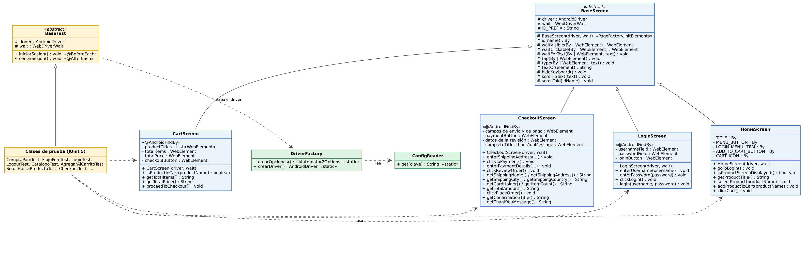

# Avance 4.1 – Introducción a Page Object Model para Mobile

## Objetivo

Diseñar la arquitectura de **Page Object Model (POM)** del proyecto: qué clases representan cada pantalla de My Demo App, qué responsabilidad tiene cada una, cómo se relacionan y cómo se organizan los paquetes. Así las pruebas dejan de contener localizadores y no se repite código entre ellas.

> En el enunciado la clase base se llama `BasePage` y las pantallas `LoginPage`, `HomePage`, `CartPage` y `CheckoutPage`. En este proyecto se usa la nomenclatura **Screen** (`BaseScreen`, `LoginScreen`, `HomeScreen`, `CartScreen`, `CheckoutScreen`), que es la que corresponde a una aplicación móvil y la que pide el desafío integrador. Son las mismas clases con otro nombre.

## 1. Pantallas y clases

| Clase | Pantallas de la app que representa | Responsabilidad |
|---|---|---|
| `BaseScreen` | Ninguna (clase abstracta) | Guarda el driver y las esperas, y reúne las acciones comunes: esperar, tocar, escribir, ocultar el teclado y hacer scroll |
| `LoginScreen` | Login | Ingreso de credenciales y autenticación |
| `HomeScreen` | Catálogo de productos y detalle del producto | Navegación principal: menú, selección de productos, agregar al carrito |
| `CartScreen` | Carrito | Productos agregados, cantidad de ítems y acceso al checkout |
| `CheckoutScreen` | Envío, pago, revisión y confirmación | Datos de la compra y finalización del pedido |

## 2. Diagrama de clases UML



El archivo editable es [`diagrama-clases-pom.dot`](diagrama-clases-pom.dot) (Graphviz). Para regenerar la imagen: `dot -Tpng -Gdpi=110 diagrama-clases-pom.dot -o diagrama-clases-pom.png`.

Cómo se lee:

- **Flecha con triángulo vacío:** herencia. Las cuatro pantallas extienden `BaseScreen`; `CheckoutScreen` estaba solo definida en este avance y se implementó en el Avance 4.3. El diagrama se actualizó en el 4.3 y muestra el estado actual del proyecto.
- **Flecha punteada con punta abierta:** dependencia (`usa`). Las clases de prueba usan las pantallas, y `BaseTest` crea el driver con `DriverFactory`, que lee `ConfigReader`.
- **Símbolos:** `#` protegido, `+` público, `-` privado, `~` visibilidad de paquete.

## 3. Diseño de `BaseScreen`

Centraliza lo que todas las pantallas necesitan, para que ninguna lo repita:

| Elemento | Detalle |
|---|---|
| Atributos | `driver` (`AndroidDriver`) y `wait` (`WebDriverWait`), recibidos por constructor |
| Búsqueda de elementos | `id(name)` arma el localizador con el prefijo del paquete de la app |
| Esperas | `waitVisible`, `waitClickable` y `waitForText` (siempre explícitas, sin `Thread.sleep`) |
| Interacciones básicas | `tap`, `type` (limpia y escribe), `hideKeyboard` y `scrollToText` |

## 4. Responsabilidades y métodos principales

**`LoginScreen`**: `enterUsername(username)`, `enterPassword(password)`, `clickLogin()` y `login(username, password)`, que reutiliza los tres anteriores.

**`HomeScreen`**: `goToLogin()`, `isProductScreenDisplayed()`, `getProductTitle()`, `selectProduct(productName)`, `addProductToCart(productName)` y `clickCart()`.

**`CartScreen`**: `isProductInCart(productName)`, `getTotalItems()` y `proceedToCheckout()`.

**`CheckoutScreen`** (definida aquí e implementada en el Avance 4.3): `enterShippingAddress(...)`, `clickToPayment()`, `enterPaymentDetails(...)`, `clickReviewOrder()`, `getShippingName()`, `getTotalAmount()`, `clickPlaceOrder()` y `getConfirmationTitle()`.

## 5. Herencia y principios SOLID

| Principio | Cómo se aplica |
|---|---|
| **S**: responsabilidad única | Cada clase representa una sola pantalla o función. `LoginScreen` no sabe nada del carrito, y las pruebas no contienen localizadores |
| **O**: abierto/cerrado | Para agregar una pantalla nueva se crea una clase que extiende `BaseScreen`; no hay que modificar las existentes |
| **L**: sustitución de Liskov | Cualquier pantalla puede tratarse como un `BaseScreen`, porque las subclases agregan comportamiento y no cambian el de la base |
| **I**: segregación de interfaces | Cada pantalla expone solo los métodos de su pantalla; las acciones técnicas (`tap`, `type`, esperas) son `protected` y quedan fuera del alcance de las pruebas |
| **D**: inversión de dependencias | El driver se inyecta por constructor y las pantallas no lo crean ni leen la configuración. Las pruebas dependen de métodos de negocio (`login`, `addProductToCart`), no de Appium |

## 6. Esquema de clases en Java

Atributos, constructores y métodos de cada clase, sin la lógica interna:

```text
package screens;

public abstract class BaseScreen {
    protected static final String ID_PREFIX = "com.saucelabs.mydemoapp.android:id/";
    protected final AndroidDriver driver;
    protected final WebDriverWait wait;

    protected BaseScreen(AndroidDriver driver, WebDriverWait wait)
    protected By id(String name)
    protected WebElement waitVisible(By locator)
    protected WebElement waitClickable(By locator)
    protected void waitForText(By locator, String text)
    protected void tap(By locator)
    protected void type(By locator, String text)
    protected void hideKeyboard()
    protected void scrollToText(String text)
}

public class LoginScreen extends BaseScreen {
    private static final By USERNAME_FIELD, PASSWORD_FIELD, LOGIN_BUTTON;

    public LoginScreen(AndroidDriver driver, WebDriverWait wait)
    public void enterUsername(String username)
    public void enterPassword(String password)
    public void clickLogin()
    public void login(String username, String password)
}

public class HomeScreen extends BaseScreen {
    private static final By TITLE, MENU_BUTTON, LOGIN_MENU_ITEM, ADD_TO_CART_BUTTON, CART_ICON;

    public HomeScreen(AndroidDriver driver, WebDriverWait wait)
    public void goToLogin()
    public boolean isProductScreenDisplayed()
    public String getProductTitle()
    public void selectProduct(String productName)
    public void addProductToCart(String productName)
    public void clickCart()
}

public class CartScreen extends BaseScreen {
    private static final By TOTAL_ITEMS, CHECKOUT_BUTTON;

    public CartScreen(AndroidDriver driver, WebDriverWait wait)
    public boolean isProductInCart(String productName)
    public String getTotalItems()
    public void proceedToCheckout()
}

public class CheckoutScreen extends BaseScreen {
    public CheckoutScreen(AndroidDriver driver, WebDriverWait wait)
    public void enterShippingAddress(String fullName, String address, String city,
                                     String state, String zip, String country)
    public void clickToPayment()
    public void enterPaymentDetails(String holder, String cardNumber, String expiry, String securityCode)
    public void clickReviewOrder()
    public String getShippingName()
    public String getTotalAmount()
    public void clickPlaceOrder()
    public String getConfirmationTitle()
}
```

`LoginScreen`, `HomeScreen` y `CartScreen` se implementaron en el [Avance 4.2](avance-4.2.md) y `CheckoutScreen` en el [Avance 4.3](avance-4.3.md), donde también se migró a Page Factory. Los métodos finales de `CheckoutScreen` incluyen además los de lectura de la revisión del pedido.

## 7. Estructura de paquetes

```text
appium-mobile-automation
├── pom.xml
├── docs
└── src
    └── test
        ├── java
        │   ├── config                 componentes de configuración
        │   │   ├── ConfigReader.java
        │   │   └── DriverFactory.java
        │   ├── screens                Page Objects (una clase por pantalla)
        │   │   ├── BaseScreen.java
        │   │   ├── LoginScreen.java
        │   │   ├── HomeScreen.java
        │   │   ├── CartScreen.java
        │   │   └── CheckoutScreen.java
        │   └── tests                  clases de prueba y su base
        │       ├── BaseTest.java
        │       ├── FlujoPomTest.java
        │       ├── CompraPomTest.java
        │       ├── LoginTest.java
        │       ├── LogoutTest.java
        │       ├── CatalogoTest.java
        │       ├── AgregarAlCarritoTest.java
        │       ├── ScrollHastaProductoTest.java
        │       ├── CheckoutTest.java
        │       └── AppiumTest.java
        └── resources
            ├── config.properties
            └── apks
                └── mda-2.2.0-25.apk
```

Los tres paquetes separan responsabilidades: `screens` sabe cómo es la app, `tests` decide qué se verifica y `config` sabe cómo se conecta al dispositivo. Una prueba nunca importa clases de Appium para buscar elementos; solo usa `screens`.

## Entregables

- Diagrama de clases UML: [`diagrama-clases-pom.png`](diagrama-clases-pom.png).
- Esquema de clases en Java: sección 6.
- Estructura de paquetes: sección 7.
