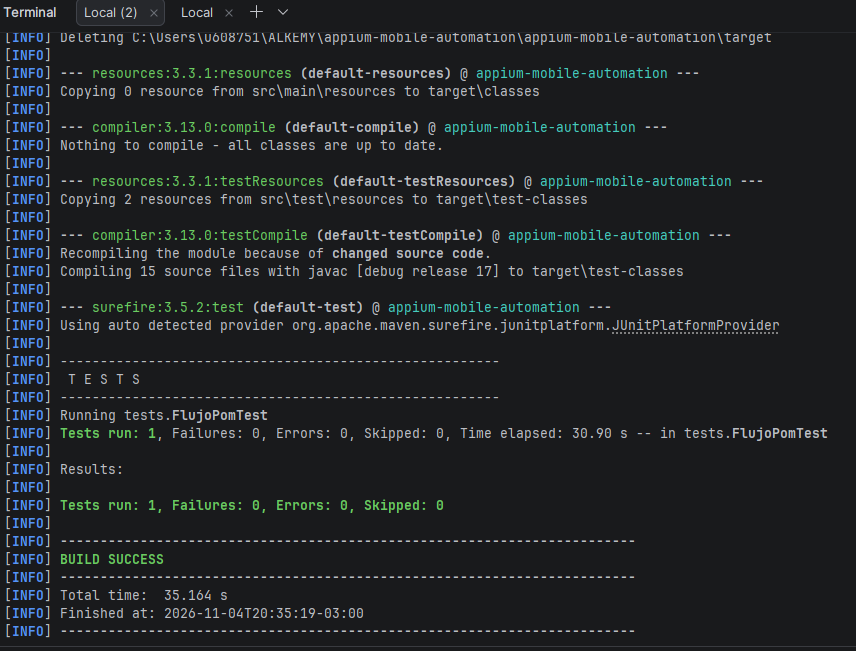

# Avance 4.2 – Implementación básica de POM Mobile

## Objetivo

Implementar `LoginScreen` y `HomeScreen` (con la heredada `BaseScreen`) y usarlas en una prueba de JUnit 5 que recorra login, catálogo, agregar un producto y abrir el carrito, sin localizadores dentro de la prueba.

Clases nuevas: `src/test/java/screens/BaseScreen.java`, `LoginScreen.java`, `HomeScreen.java` y `CartScreen.java`. Prueba: `src/test/java/tests/FlujoPomTest.java`.

## `BaseScreen`

Clase abstracta con el driver y las acciones comunes que heredan las pantallas: `id()`, `waitVisible()`, `waitClickable()`, `waitForText()`, `tap()`, `type()`, `hideKeyboard()` y `scrollToText()`. Todas las esperas son explícitas.

## `LoginScreen`

| Método | Qué hace |
|---|---|
| `enterUsername(String username)` | Espera el campo `nameET`, lo limpia y escribe el usuario |
| `enterPassword(String password)` | Igual con `passwordET` |
| `clickLogin()` | Oculta el teclado si está abierto y toca `loginBtn` |
| `login(String username, String password)` | Ejecuta los tres métodos anteriores |

Localizadores (privados, dentro de la clase): `nameET`, `passwordET` y `loginBtn`, del relevamiento en [`mapeo-elementos.md`](mapeo-elementos.md).

## `HomeScreen`

| Método | Qué hace |
|---|---|
| `isProductScreenDisplayed()` | Devuelve `true` si el título `productTV` muestra "Products" dentro del tiempo de espera |
| `getProductTitle()` | Devuelve el texto de `productTV`: "Products" en el catálogo y el nombre del producto en el detalle |
| `selectProduct(String productName)` | Hace scroll hasta el producto, toca su imagen y espera que el título cambie al nombre del producto |
| `addProductToCart(String productName)` | Abre el detalle del producto si todavía no está en él y toca *Add to cart* |
| `clickCart()` | Toca el acceso al carrito (`View cart`) |
| `goToLogin()` | Menú lateral → *Log In* (necesario para llegar a la pantalla de login) |

Se identificaron con Appium Inspector (ver `mapeo-elementos.md`) los elementos del catálogo: `productTV`, `menuIV`, la imagen del producto (`Product Image`), `Tap to add product to cart` y `View cart`.

Detalles que resuelve la clase para que no los repita ninguna prueba:

- `productTV` es el mismo elemento en el catálogo y en el detalle, por eso se espera por **texto** para confirmar el cambio de pantalla.
- En la tarjeta del catálogo solo la imagen recibe el toque, no el título; por eso `selectProduct` toca la imagen que acompaña al nombre.

## `CartScreen` (apoyo para verificar el último paso)

`isProductInCart(productName)`, `getTotalItems()` y `proceedToCheckout()`. Permite comprobar en la prueba que el producto llegó al carrito.

## Prueba: `FlujoPomTest`

Etiqueta `POM`. Sigue el patrón AAA:

```text
// Arrange: crear las pantallas e ir al login desde el menú
HomeScreen home = new HomeScreen(driver, wait);
LoginScreen login = new LoginScreen(driver, wait);
CartScreen cart = new CartScreen(driver, wait);
home.goToLogin();

// Act: iniciar sesión, elegir un producto, agregarlo y abrir el carrito
login.login(USUARIO_VALIDO, CLAVE);
home.selectProduct("Sauce Labs Backpack");
home.addProductToCart("Sauce Labs Backpack");
home.clickCart();

// Assert (agrupadas con assertAll)
catálogo visible, título "Products", detalle con el producto elegido,
producto en el carrito, 1 ítem en el carrito
```

Cubre los siete pasos del enunciado: iniciar la app, ingresar credenciales, presionar Login, verificar el catálogo, seleccionar un producto, agregarlo al carrito y acceder al carrito.

## Reutilización y encapsulamiento

- Las pantallas reutilizan `BaseScreen`: ninguna repite esperas ni acciones.
- Los localizadores son constantes privadas de cada pantalla; la prueba no importa Appium ni `By`.
- No se duplica código: las pruebas anteriores siguen usando `BaseTest` y se irán migrando a las pantallas en los próximos avances.

## Ejecución

Con el emulador y el servidor Appium en marcha:

```bash
mvn clean test "-Dtest=FlujoPomTest"
mvn clean test "-Dgroups=POM"
```

Resultado esperado: `Tests run: 1, Failures: 0, Errors: 0`.

Evidencia: `capturas/13-pom-ejecucion-exitosa.png`



## Entregables

- Prueba automatizada con JUnit 5 que integra `LoginScreen` y `HomeScreen` y valida el login, el catálogo y las interacciones pedidas.
- Repositorio con el código organizado en paquetes `config`, `screens` y `tests`.
