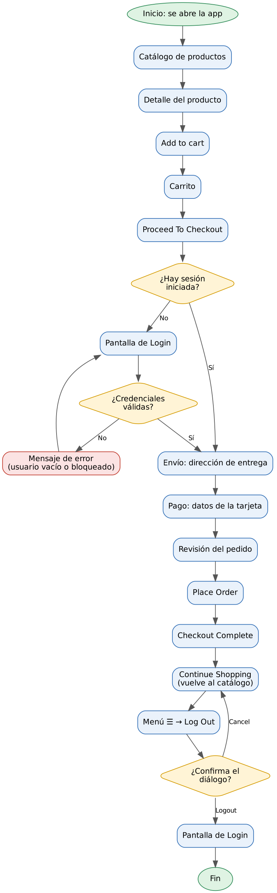

# Flujo de compra y pantallas identificadas (Android)

**Proyecto:** `appium-mobile-automation`
**App bajo prueba:** My Demo App de Sauce Labs (`mda-2.2.0-25.apk`, paquete `com.saucelabs.mydemoapp.android`)
**Plataforma:** Android nativo sobre emulador (`emulator-5554`)

## 1. Diagrama de flujo del proceso

El archivo editable es [`diagrama-flujo-compra.dot`](diagrama-flujo-compra.dot) (Graphviz). Para regenerar la imagen: `dot -Tpng -Gdpi=130 diagrama-flujo-compra.dot -o diagrama-flujo-compra.png`.

El flujo cubre las cinco etapas del caso de negocio: **selección de artículo, carrito, login, checkout y logout**. Tres decisiones del flujo se comprobaron en la aplicación:

- La app abre directamente en el catálogo: no exige login para navegar ni para agregar productos al carrito.
- El login se pide al tocar *Proceed To Checkout* si no hay sesión iniciada. También se puede entrar antes desde el menú ☰ → Log In.
- Al confirmar el logout, la app vuelve a la pantalla de Login.

## 2. Listado de pantallas identificadas

| # | Pantalla | Cómo se llega | Elementos clave (detalle en [`mapeo-elementos.md`](mapeo-elementos.md)) |
|---|---|---|---|
| 1 | Catálogo de productos | Al abrir la app, o con *Continue Shopping* | `productTV` (título), `productRV` (lista), `titleTV`, `priceTV`, `productIV`, `cartRL`, `menuIV` |
| 2 | Detalle del producto | Tocar la imagen de un producto | `productTV` (nombre del producto), `cartBt` (*Add to cart*), `noTV` |
| 3 | Carrito | Ícono del carrito (`cartRL`, *View cart*) | `productRV`, `titleTV`, `noTV`, `priceTV`, `minusIV`, `plusIV`, `removeBt`, `itemsTV`, `totalPriceTV`, `cartBt` (*Proceed To Checkout*), `shoppingBt` |
| 4 | Login | Menú ☰ → Log In, o *Proceed To Checkout* sin sesión | `nameET`, `passwordET`, `loginBtn`, `nameErrorTV`, `passwordErrorTV` |
| 5 | Checkout: envío | Después del login (o del carrito si ya hay sesión) | `fullNameET`, `address1ET`, `address2ET`, `cityET`, `stateET`, `zipET`, `countryET`, `paymentBtn` (*To Payment*) |
| 6 | Checkout: pago | *To Payment* | `nameET`, `cardNumberET`, `expirationDateET`, `securityCodeET`, `billingAddressCB`, `paymentBtn` (*Review Order*) |
| 7 | Checkout: revisión del pedido | *Review Order* | `placeOrderRV`, `fullNameTV`, `addressTV`, `cityTV`, `countryTV`, `cardHolderTV`, `itemNumberTV`, `totalAmountTV`, `paymentBtn` (*Place Order*) |
| 8 | Confirmación de compra | *Place Order* | `completeTV` (*Checkout Complete*), `thankYouTV`, `shoopingBt` (*Continue Shopping*) |
| 9 | Menú de navegación y diálogo de logout | Ícono ☰ (`menuIV`) | Opción *Log Out* (accessibility id `Logout Menu Item`), `alertTitle`, `android:id/button1` (*LOGOUT*), `android:id/button2` (*CANCEL*) |

## 3. Observaciones sobre el flujo

- Algunos identificadores se comparten entre pantallas (`productTV`, `paymentBtn`, `nameET`, `cartBt`). Por eso las esperas de los tests confirman el cambio de pantalla por **texto** y no solo por la presencia del elemento.
- En el catálogo solo la imagen del producto responde al toque; el título no.
- La confirmación del pedido incluye un botón con el identificador `shoopingBt` (con dos "o"), distinto de `shoppingBt` del carrito vacío. El error de tipeo está en la propia aplicación.
