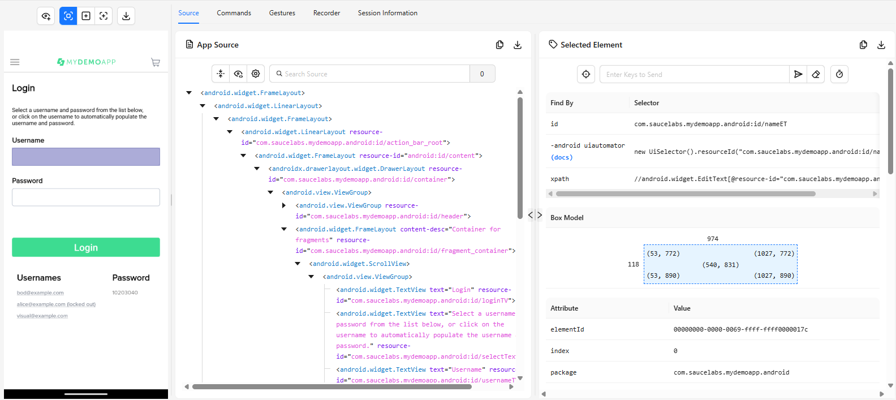
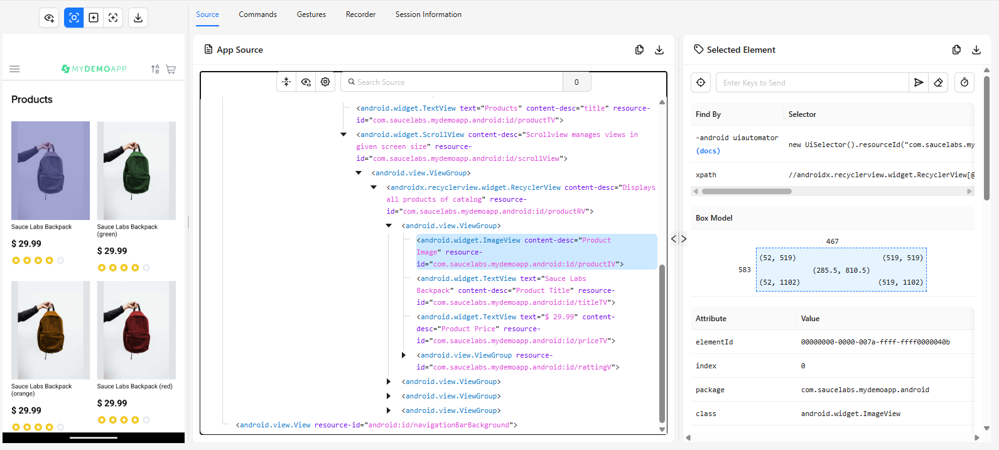
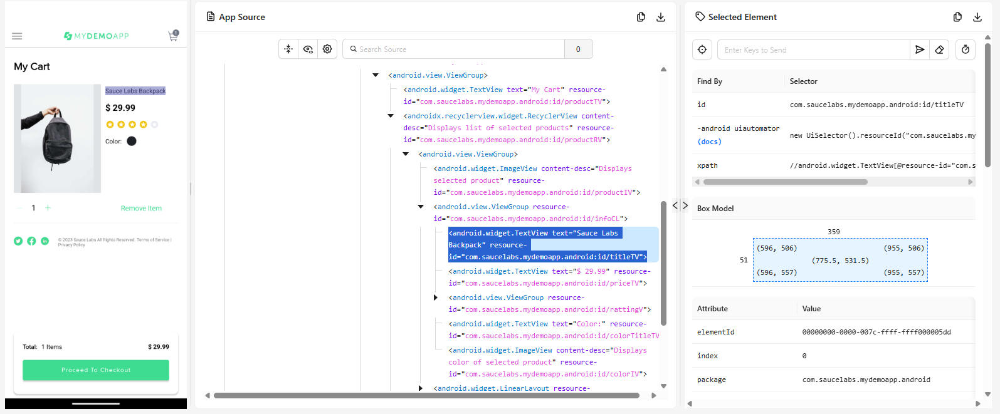
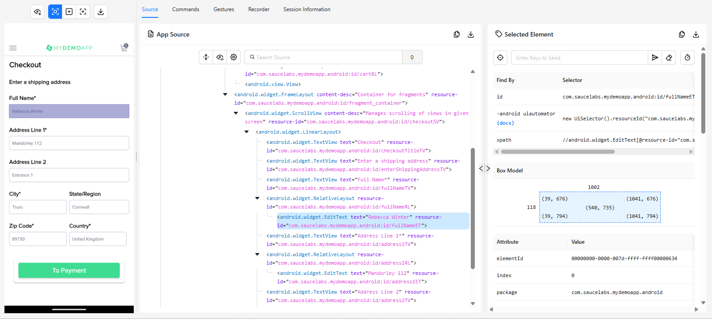
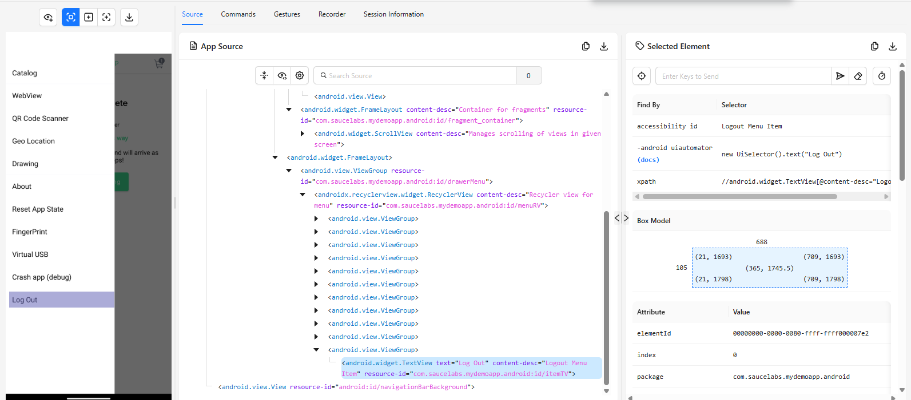

# Mapeo inicial de elementos: My Demo App (Sauce Demo)

**Proyecto:** `appium-mobile-automation`
**App bajo prueba:** My Demo App de Sauce Labs (`mda-2.2.0-25.apk`, paquete `com.saucelabs.mydemoapp.android`)
**Herramienta de relevamiento:** Appium Inspector conectado a Appium Server 3.8.0, UiAutomator2, emulador Pixel_9 (`emulator-5554`)
**Flujo analizado:** Login → Selección de productos → Carrito → Checkout → Logout

Todos los valores de este documento fueron confirmados en Appium Inspector sobre la aplicación en ejecución. En las tablas, el prefijo de los `resource-id` es `com.saucelabs.mydemoapp.android:id/`, salvo en los que se indica otra cosa.

## Criterio de selección de estrategia

1. **ID** (`resource-id`), cuando es único y estable.
2. **Accessibility ID** (`content-desc`), cuando el `resource-id` no sirve (por ejemplo, porque lo comparten varios elementos).
3. **XPath**, solo si no existe ninguna de las anteriores. En este relevamiento no hizo falta usarlo.

## Capabilities usadas en Appium Inspector

```json
{
  "platformName": "Android",
  "appium:automationName": "UiAutomator2",
  "appium:udid": "emulator-5554",
  "appium:deviceName": "emulator-5554",
  "appium:appPackage": "com.saucelabs.mydemoapp.android",
  "appium:appActivity": "com.saucelabs.mydemoapp.android.view.activities.SplashActivity",
  "appium:appWaitActivity": "*",
  "appium:newCommandTimeout": 900,
  "appium:noReset": true
}
```

## 1. Login

La app abre en el catálogo. Se llega al Login desde el menú (☰) → **Log In**.

La pantalla lista usuarios de prueba (`bod@example.com`, `alice@example.com` bloqueado y `visual@example.com`) con la contraseña `10203040`. Al tocar un usuario de la lista, los campos Username y Password se completan solos.



| Elemento | Atributo encontrado | Valor | Estrategia elegida |
|---|---|---|---|
| Campo Username | resource-id | `nameET` | ID |
| Campo Password | resource-id | `passwordET` | ID |
| Botón Login | resource-id | `loginBtn` (content-desc: `Tap to login with given credentials`) | ID |
| Mensaje de error: usuario vacío | resource-id | `nameErrorTV` (texto: `Username is required`) | ID |
| Ícono de error junto a Username | resource-id | `usernameErrorIV` (content-desc: `Indicates error`) | ID |
| Mensaje de error: contraseña vacía o usuario bloqueado | resource-id | `passwordErrorTV` (texto: `Enter Password` o `Sorry this user has been locked out.`) | ID |

## 2. Selección de productos



| Elemento | Atributo encontrado | Valor | Estrategia elegida |
|---|---|---|---|
| Título de la pantalla | resource-id | `productTV` (content-desc: `title`) | ID |
| Listado de productos | resource-id | `productRV` (content-desc: `Displays all products of catalog`) | ID |
| Nombre del producto | resource-id | `titleTV` (content-desc: `Product Title`) | ID (varios resultados, ver observaciones) |
| Precio | resource-id | `priceTV` (content-desc: `Product Price`) | ID (varios resultados, ver observaciones) |
| Imagen | resource-id | `productIV` (content-desc: `Product Image`) | ID (varios resultados, ver observaciones) |
| Botón para agregar al carrito (en el detalle del producto) | resource-id | `cartBt` (content-desc: `Tap to add product to cart`, texto: `Add to cart`) | ID |
| Acceso al carrito | resource-id | `cartRL` (content-desc: `View cart`; el ícono interno es `cartIV`) | ID |

## 3. Carrito



| Elemento | Atributo encontrado | Valor | Estrategia elegida |
|---|---|---|---|
| Listado de productos agregados | resource-id | `productRV` (content-desc: `Displays list of selected products`) | ID |
| Nombre del producto | resource-id | `titleTV` | ID (varios resultados con más de un producto) |
| Cantidad de cada producto | resource-id | `noTV` (texto: `1`) | ID (varios resultados con más de un producto) |
| Precio de cada producto | resource-id | `priceTV` (texto: `$ 29.99`) | ID (varios resultados con más de un producto) |
| Botón para disminuir la cantidad | resource-id | `minusIV` (content-desc: `Decrease item quantity`) | ID (varios resultados con más de un producto) |
| Botón para aumentar la cantidad | resource-id | `plusIV` (content-desc: `Increase item quantity`) | ID (varios resultados con más de un producto) |
| Botón para eliminar un producto | resource-id | `removeBt` (texto: `Remove Item`, content-desc: `Removes product from cart`) | ID (varios resultados con más de un producto) |
| Cantidad total de ítems | resource-id | `itemsTV` (texto: `1 Items`) | ID |
| Precio total | resource-id | `totalPriceTV` (texto: `$ 29.99`) | ID |
| Botón para iniciar el Checkout | resource-id | `cartBt` (texto: `Proceed To Checkout`, content-desc: `Confirms products for checkout`) | ID |
| Botón para continuar comprando (carrito vacío) | resource-id | `shoppingBt` (texto: `Go Shopping`) | ID |

## 4. Checkout

El checkout tiene cuatro pasos: dirección de envío, pago, revisión del pedido y confirmación. Los cuatro se resumen en esta tabla; la captura corresponde al formulario de envío.



| Elemento | Atributo encontrado | Valor | Estrategia elegida |
|---|---|---|---|
| Envío: Full Name | resource-id | `fullNameET` | ID |
| Envío: Address Line 1 | resource-id | `address1ET` | ID |
| Envío: Address Line 2 | resource-id | `address2ET` | ID |
| Envío: City | resource-id | `cityET` | ID |
| Envío: State/Region | resource-id | `stateET` | ID |
| Envío: Zip Code | resource-id | `zipET` | ID |
| Envío: Country | resource-id | `countryET` | ID |
| Botón para continuar (a Pago) | resource-id | `paymentBtn` (texto: `To Payment`, content-desc: `Saves user info for checkout`) | ID |
| Pago: Full Name (titular) | resource-id | `nameET` | ID |
| Pago: Card Number | resource-id | `cardNumberET` | ID |
| Pago: Expiration Date | resource-id | `expirationDateET` | ID |
| Pago: Security Code | resource-id | `securityCodeET` | ID |
| Pago: casilla de dirección de facturación | resource-id | `billingAddressCB` (content-desc: `Select if User billing address and shipping address are same`) | ID |
| Botón para continuar (a Revisión) | resource-id | `paymentBtn` (texto: `Review Order`, content-desc: `Saves payment info and launches screen to review checkout data`) | ID |
| Resumen de la compra (productos) | resource-id | `placeOrderRV` (content-desc: `Displays list of selected products`) | ID |
| Resumen: nombre, dirección, ciudad y país de envío | resource-id | `fullNameTV`, `addressTV`, `cityTV`, `countryTV` | ID |
| Resumen: titular de la tarjeta | resource-id | `cardHolderTV` | ID |
| Cantidad de ítems del pedido | resource-id | `itemNumberTV` (texto: `1 Items`) | ID |
| Precio total | resource-id | `totalAmountTV` (texto: `$ 35.98`) | ID |
| Botón para finalizar la compra | resource-id | `paymentBtn` (texto: `Place Order`, content-desc: `Completes the process of checkout`) | ID |
| Mensaje de confirmación | resource-id | `completeTV` (texto: `Checkout Complete`) | ID |
| Mensaje de agradecimiento | resource-id | `thankYouTV` (texto: `Thank you for your order`) | ID |
| Botón para volver al catálogo | resource-id | `shoopingBt` (texto: `Continue Shopping`, content-desc: `Tap to open catalog`) | ID |

## 5. Logout



| Elemento | Atributo encontrado | Valor | Estrategia elegida |
|---|---|---|---|
| Menú de navegación (ícono ☰) | resource-id | `menuIV` (content-desc: `View menu`) | ID |
| Opción Logout | content-desc | `Logout Menu Item` (texto: `Log Out`; `resource-id`: `itemTV`, compartido por todas las opciones del menú) | Accessibility ID |
| Título del cuadro de confirmación | resource-id | `alertTitle` (texto: `Log Out`) | ID |
| Botón de confirmación del diálogo | resource-id | `android:id/button1` (texto: `LOGOUT`) | ID |
| Botón de cancelación del diálogo | resource-id | `android:id/button2` (texto: `CANCEL`) | ID |

## Observaciones

**Identificadores repetidos dentro de una lista**
- En el catálogo y en el carrito, `titleTV`, `priceTV`, `productIV`, `noTV`, `minusIV`, `plusIV` y `removeBt` aparecen una vez por cada producto. Con ID, `findElement` devuelve solo el primero. Para elegir uno en particular hay que usar `findElements` y la posición, o un XPath por texto.
- El panel *Find By* del Inspector lo refleja: para estos elementos no ofrece `id` ni `accessibility id` (solo `-android uiautomator` con `.instance(0)` y `xpath`). Con un único producto en el carrito sí ofrece `id`, porque deja de haber repetidos.
- Los `content-desc` de las tarjetas del catálogo (`Product Title`, `Product Price`, `Product Image`) también se repiten, así que tampoco distinguen un producto de otro.

**Identificadores compartidos entre pantallas (conviene separarlos por pantalla en los Page Objects)**
- `productRV`: catálogo y carrito.
- `cartBt`: botón "Add to cart" (detalle del producto) y botón "Proceed To Checkout" (carrito). Los `content-desc` sí son distintos.
- `noTV`: cantidad en el detalle del producto y en el carrito.
- `paymentBtn`: botón principal de los tres pasos del checkout; cambia el texto (`To Payment`, `Review Order`, `Place Order`) y el `content-desc`.
- `nameET`: Username en el Login y titular de la tarjeta en el Pago.
- `fullNameTV`, `cityTV`, `countryTV`: en el formulario de envío son las etiquetas ("Full Name*", "City*", "Country*") y en la revisión del pedido son los valores ingresados.

**Comportamientos a tener en cuenta en las pruebas**
- `passwordErrorTV` es un único elemento que cambia de texto según el caso (`Enter Password` o `Sorry this user has been locked out.`). Para validar un mensaje hay que comparar el texto.
- Los campos de texto vacíos muestran su *hint* como valor de `text` (por ejemplo, `fullNameET` devuelve `Rebecca Winter` con `showing-hint="true"`). Leer el texto de un campo vacío devuelve la sugerencia, no una cadena vacía.
- Campos obligatorios del envío: Full Name, Address Line 1, City, Zip Code y Country. Address Line 2 y State/Region son opcionales. `zipET`, `cardNumberET`, `expirationDateET` y `securityCodeET` son numéricos; `securityCodeET` acepta 3 caracteres como máximo.
- La casilla `billingAddressCB` viene tildada por defecto.
- El total de la revisión del pedido (`$ 35.98`) no coincide con el del carrito (`$ 29.99`); la diferencia corresponde al costo de envío, que se agrega en el último paso.
- `itemsTV`, `itemNumberTV`, `totalPriceTV` y `totalAmountTV` incluyen el símbolo y el texto en el valor (`1 Items`, `$ 35.98`), por lo que una validación numérica requiere procesar el texto.

**Nombres de ID a escribir con cuidado**
- `shoopingBt` (con dos "o", botón "Continue Shopping" de la confirmación) es distinto de `shoppingBt` (botón "Go Shopping" del carrito vacío). El error de tipeo está en la propia aplicación.

**Menú y diálogos**
- Todas las opciones del menú de navegación comparten el `resource-id` `itemTV`, y solo "Log In" y "Log Out" tienen `content-desc` (`Login Menu Item` y `Logout Menu Item`). Por eso Logout se localiza por Accessibility ID.
- El cuadro de confirmación de Logout usa identificadores estándar de Android (`alertTitle`, `android:id/button1`, `android:id/button2`).

**Hallazgo a confirmar**
- En la pantalla de confirmación del pedido ("Checkout Complete"), el contador del carrito del encabezado (`cartTV`) siguió mostrando `1`. Queda pendiente confirmar si es un defecto de la aplicación o si se actualiza al volver al catálogo.

**Resultado**
- Todos los elementos del flujo se pudieron localizar por ID o por Accessibility ID. No fue necesario usar XPath.
